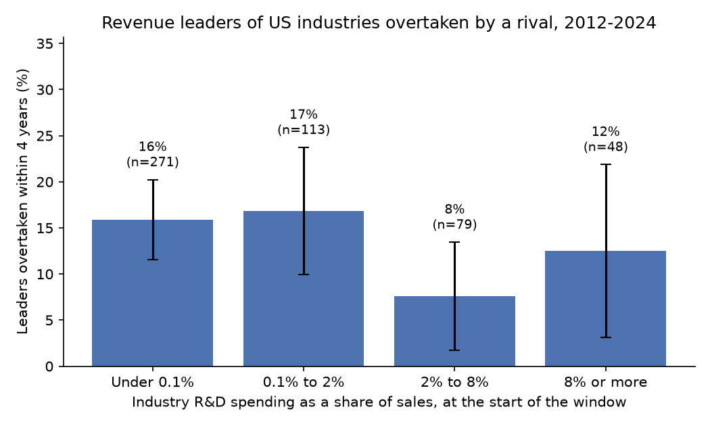
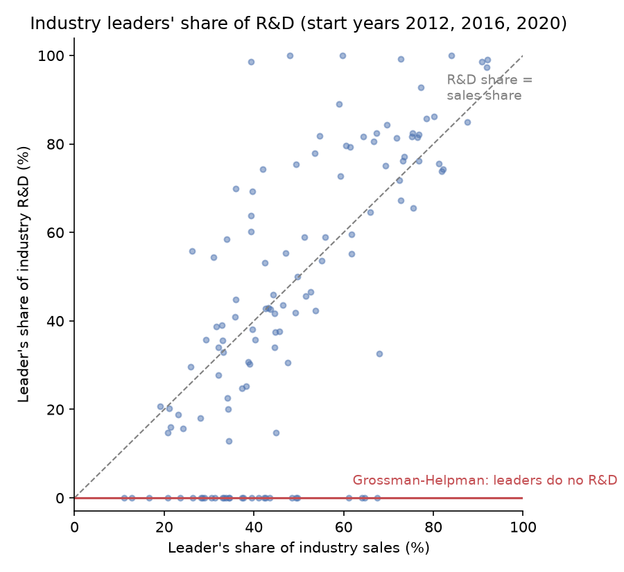

# Who Climbs the Ladder

### In 1991, Gene Grossman and Elhanan Helpman described economic growth as a ladder that challengers climb and leaders fall off. Using company filings from 2012 to 2024, I checked who is doing the climbing.

---

For most of the personal computer era the sticker on the laptop said "Intel Inside." In 2020 Intel was still the
largest chipmaker filing annual reports with the Securities and Exchange Commission from an American address, with
$77.9 billion of revenue, and it spent $13.6 billion of that on research and development. Nvidia, then known mostly
for the graphics cards in gaming computers, had $16.7 billion of revenue in its fiscal year ending January 2021 and
spent 23.5% of it on research. Four years later Nvidia's revenue was $130.5 billion (fiscal year ending January 2025)
and Intel's 2024 revenue had fallen to $53.1 billion, and the leader of the American chip industry by sales was no
longer Intel.

That story is the one economists tell about how rich countries keep getting richer. A company invents something
better, takes the market, earns a monopoly profit for a while, and loses it when someone else invents something
better still. Two economists, Gene Grossman of Princeton and Elhanan Helpman of Tel Aviv University, wrote down
the cleanest version of it in 1991. Their model makes two predictions that can be checked against what American
companies report to the SEC every year. Leaders should fall faster in industries that spend more on research, and
leaders should do no research at all. I tested both against the filings of 4,823 American public companies from
2012 to 2024.

---

## Two numbers for an industry

The first number is research intensity, the share of an industry's sales that its companies spend on research and
development. For industry $`j`$ with companies $`i`$, research spending $`RD_{ij}`$ and revenue $`Y_{ij}`$:

```math
s_j = \frac{\sum_i RD_{ij}}{\sum_i Y_{ij}}
```

For a single company the sums drop out. Intel in 2020 is the worked example:

```math
s_{\text{Intel, 2020}} = \frac{13.556}{77.867} = 17.4\%
```

Research intensity varies widely from one industry to the next. These are real industries, defined by their
four-digit Standard Industrial Classification (SIC) codes, at the start of a window in my sample.

| Industry and year | Largest company | Research spending as a share of sales |
|---|---|---|
| Variety stores, 2012 | Walmart | 0% (none reported) |
| Electronic computers, 2012 | Apple | 2.2% |
| Biological products, 2020 | Amgen | 28.4% |

The second number is how fast leaders lose their place. If a fraction $`p`$ of industry leaders are passed by a
rival within a window of $`T`$ years, and the chance of being passed is the same in every year, the annual rate (the
hazard) $`\iota`$ and the expected time at the top follow from the exponential distribution:

```math
\iota = -\frac{\ln(1-p)}{T}, \qquad \text{expected tenure} = \frac{1}{\iota}
```

Across all 511 industry windows in my data, 14.48% of leaders were passed within four years:

```math
\iota = -\frac{\ln(1 - 0.1448)}{4} = 0.0391, \qquad \frac{1}{0.0391} = 25.6\ \text{years}
```

So an American industry leader loses its place at a rate of about 3.9% a year, and the typical leader can expect
to stay on top for about a quarter of a century. In the Grossman and Helpman model this hazard is the industry's
rate of innovation.

---

## The paper and its authors

Gene Grossman was born in New York in 1955, studied at Yale, finished a PhD at MIT in 1980 and went straight to
Princeton, where he has been the Jacob Viner Professor of International Economics since 1992. Elhanan Helpman was
born in 1946 in what is now Kyrgyzstan, moved with his family to Israel, took his PhD at Harvard in 1974 and taught
at Tel Aviv University from 1974 to 2004. He returned to Harvard in 1997, where he is the Galen L. Stone Professor of
International Trade. Their long partnership produced, among much else, the book *Innovation and Growth in the
Global Economy* (MIT Press, 1991), which joined this paper's quality ladders to international trade.

"Quality Ladders in the Theory of Growth" first circulated as NBER Working Paper 3099 in September 1989 and appeared
in the *Review of Economic Studies* in January 1991. They built it partly in answer to Philippe Aghion and Peter
Howitt, whose growth model had a single innovator improving every product at once. Grossman and Helpman gave each
product its own ladder. Every rung is better than the last by a factor $`\lambda > 1`$, and entrepreneurs race to
climb the next rung of each product. The current leader can make the top quality; a rival one rung down can make
the previous one. Competition on price lets the leader charge just under the rival's quality-adjusted cost. With a
wage $`w`$ and total spending $`E`$ on each product, the leader's price and profit are

```math
p = \lambda w, \qquad \pi = \left(1 - \frac{1}{\lambda}\right)E
```

The model then makes two strong claims. A leader is displaced whenever a rival's research succeeds, which happens
at a Poisson rate $`\iota`$, so leadership lasts on average $`1/\iota`$ years. And, in their words, "without any
cost advantage, an industry leader will not engage in R&D." An outsider who climbs one rung gains the whole profit;
a leader who climbs a rung only widens a lead it already has, which is worth a fraction $`1/\lambda`$ as much. Growth
of living standards is the rate of innovation times the size of each step, $`g = \iota\ln\lambda`$.

The model's link between research spending and displacement is the formula my test rests on. Assume, as the paper
does, that one unit of research intensity costs $`a_I`$ workers, that anyone may do research (free entry), that
investors require a return $`\rho`$ on a leader's shares, which become worthless when it is displaced, and that the
economy is in steady state. With the wage set to one, the value of a leadership position is $`v`$, and

```math
\begin{aligned}
v &= a_I && \text{(free entry: value = cost of research)} \\
\frac{\pi}{v} &= \rho + \iota && \text{(return = discount rate + risk of displacement)} \\
a_I &= \frac{(1-1/\lambda)\,E}{\rho + \iota} \\
s \equiv \frac{a_I\,\iota}{E} &= \left(1 - \frac{1}{\lambda}\right)\frac{\iota}{\rho + \iota} \\
\Rightarrow\quad \iota &= \frac{\rho\, s}{(1 - 1/\lambda) - s}
\end{aligned}
```

In words, an industry's research spending as a share of its sales rises with how fast its leaders are being
replaced, so industries that spend more on research should see their leaders fall more often.

The strongest objection came from Daniel Garcia-Macia, Chang-Tai Hsieh and Peter Klenow, whose 2019 paper on how
destructive innovation is used Census data on all nonfarm private American businesses from 1983 to 2013. They
concluded that most growth comes from incumbents, and that incumbents improving their own products matter more than
outsiders displacing them. Charles Jones raised a different objection in 1995, that the prediction of models of
this kind that a larger economy grows permanently faster is inconsistent with the time-series evidence from
industrialized economies. The first objection is the one this repository can test, and it matters because the two
views point policy in opposite directions. If growth comes from challengers, the job of antitrust is to keep the
ladder open to them. If it comes from leaders improving their own products, protecting leaders' rewards matters more.

---

## How I tested it

The paper has no data, so the test is mine. I used the SEC's Financial Statement Data Sets, which hold every number
that public companies tag in their annual 10-K reports, and took revenue, cost of revenue and research spending for
fiscal years 2012, 2016, 2020 and 2024. A fiscal year ending between January and June counts as the previous
calendar year, so Nvidia's year ending January 2025 is its 2024 and Microsoft's year ending June 2017 is its 2016.
SEC's servers refused requests from my address during the work, so the
script falls back to the Internet Archive's copies of the same SEC files. An industry is a four-digit SIC code. I
kept companies with an American business address and at least $10 million of revenue, dropped banks, insurers and
other financial firms (whose revenue is not product sales), and required at least five companies in an industry at
the start of a window. That leaves 10,948 company-years from 4,823 companies, and 511 industry windows in 196
industries.

The leader is the company with the most revenue in the start year. It counts as overtaken if, four years later, it
is still reporting and a rival that was already in the industry has more revenue. I set two cases aside from the
main measure. A leader that stops reporting may have been acquired, gone private, or changed its SEC identity (Google
became Alphabet in 2015), and a "rival" missing from the start-year data may be a newcomer or simply a company whose
revenue I could not read that year (ExxonMobil tagged its 2012 revenue with a label of its own). Both versions are
reported in the technical notes. For industry $`j`$ in window $`w`$, with $`N_{jw}`$ companies at the start and a
fixed effect $`\alpha_w`$ for each window, the estimating equation is

```math
\text{Overtaken}_{jw} = \alpha_w + \beta\, s_{jw} + \gamma \ln N_{jw} + \varepsilon_{jw},
\qquad H_0:\ \beta \le 0 \quad \text{vs.} \quad H_1:\ \beta > 0
```

with $`s_{jw}`$ in percentage points, so $`\beta`$ is the change in the chance of being overtaken for each extra
point of research intensity. The number of companies is there because a leader with more rivals has more ways to be
passed. Standard errors are clustered by industry, since the same industry appears in up to three windows. The
model predicts a positive $`\beta`$. I report the usual two-sided p-value and, for the one-sided test above, the
probability of a coefficient this large under $`\beta = 0`$.

---

## Leaders in research-heavy industries are not replaced any faster

| Industry research spending, share of sales | Industry windows | Leaders overtaken within 4 years | Annual hazard | Expected tenure |
|---|---|---|---|---|
| Under 0.1% (208 report none) | 271 | 15.9% | 4.3% | 23 years |
| 0.1% to 2% | 113 | 16.8% | 4.6% | 22 years |
| 2% to 8% | 79 | 7.6% | 2.0% | 51 years |
| 8% or more | 48 | 12.5% | 3.3% | 30 years |
| All | 511 | 14.5% | 3.9% | 26 years |

The industries that spend the most on research, such as software, semiconductors, drugs and medical devices, lose
their leaders no more often than retailing, trucking or utilities, and if anything a little less often. The
regression puts a number on it:

```math
\begin{aligned}
&\hat{\beta} = -0.0068\ (0.0049), \quad 95\%\ \text{CI}\ [-0.0165,\ 0.0029], \quad N = 511 \\
&p_{\text{two-sided}} = 0.17, \qquad p_{\text{one-sided},\ H_1:\ \beta > 0} = 0.91
\end{aligned}
```

Each extra point of research intensity goes with a 0.68-point lower chance of being overtaken, the opposite of the
model's sign, though too small to tell from zero. The top of the interval, 0.29 points, sits below the 0.40 points
per point of research intensity that the model's own formula implies with a 4% discount rate (a predicted 5.4%
four-year chance at 13.4% intensity against zero at none, derived in the next section). That comparison leans on my
discount rate. At 2% the formula implies 0.20 points per point, which the interval does not rule out. The number of rivals
behaves as expected, with $`\hat\gamma = 0.058`$ ($`p = 0.052`$). I tried ten other
versions of the test, counting exits as losses, counting newcomers as challengers, measuring churn in the whole top
four, dropping the pandemic window, adding broad industry-group effects, and running a logit. None gives a positive
coefficient that is statistically distinguishable from zero.



---

## Most turnover at the top has nothing to do with research

The model also says how fast leaders should fall. Feeding each group's median research intensity and median gross
margin, which stands in for $`1 - 1/\lambda`$, into the formula above, with a discount rate of 4% that is my
assumption, gives a predicted hazard. For the most research-intensive group,

```math
\iota = \frac{0.04 \times 0.1336}{0.5204 - 0.1336} = 0.0138, \qquad 1 - e^{-4 \times 0.0138} = 5.4\%
```

so the model predicts that 5.4% of these leaders fall within four years, against 12.5% in the data. Doubling the
discount rate to 8% only raises the predicted hazard to 2.8% a year. The bigger gap is at the other end. In the 271
industry windows where research is under 0.1% of sales, 208 of which report none at all, the formula predicts that
leaders essentially never fall, whatever the discount rate, yet 15.9% of them were overtaken. Leadership changes for many reasons the model leaves out.

| Industry | Leader at start | Passed by | Revenue, start → end ($ billions) | Research share of industry sales |
|---|---|---|---|---|
| Semiconductors, 2020–24 | Intel | Nvidia | Intel 77.9 → 53.1; Nvidia 16.7 → 130.5 | 16.4% |
| Surgical appliances, 2020–24 | Zimmer Biomet | Intuitive Surgical | Zimmer 7.0 → 7.7; Intuitive 4.4 → 8.4 | 8.2% |
| Biological products, 2012–16 | Amgen | Gilead Sciences | Amgen 17.3 → 23.0; Gilead 9.7 → 30.4 | 20.9% |
| Telephone service, 2020–24 | AT&T | Verizon | AT&T 171.8 → 122.3; Verizon 128.3 → 134.8 | 0.02% |
| Airlines, 2020–24 | American | Delta | American 17.3 → 54.2; Delta 17.1 → 61.6 | 0% |
| Motor vehicles, 2016–20 | General Motors | Ford | GM 166.4 → 122.5; Ford 151.8 → 127.1 | 0.4% |
| Department stores, 2012–16 | Sears | Macy's | Sears 39.9 → 22.1; Macy's 27.7 → 25.8 | 0% |

The first three rows are the ladder working the way the paper describes. Nvidia spent 23.5% of its revenue on
research in 2020 against Intel's 17.4%, and Intuitive Surgical, the maker of the da Vinci robot, spent 13.7% against
Zimmer Biomet's 5.3%. The rest are something else. AT&T fell behind because it spun off WarnerMedia, Delta passed
American as both recovered from the pandemic, General Motors and Ford traded places after GM sold its European
business, and Sears shrank on its way to bankruptcy. A rival's invention displaced none of them.

---

## Leaders do more than a third of the research

The second prediction is the sharper one, because it is a statement about zero. I took the 127 industry windows (55
industries) in which research is at least 2% of sales, where most large companies report their research
spending, and measured how much of each industry's research the leader itself does.

| Industry, start of 2020–24 window | Leader | Leader's share of industry sales | Leader's share of industry research |
|---|---|---|---|
| Electronic computers | Apple | 73.5% | 77.1% |
| Radio and TV equipment | Qualcomm | 49.4% | 75.3% |
| Computer services | Alphabet | 61.8% | 55.2% |
| Prepackaged software | Microsoft | 44.6% | 34.1% |
| Semiconductors | Intel | 32.0% | 34.1% |
| Biological products | Amgen | 34.3% | 20.0% |
| Pharmaceutical preparations | Johnson & Johnson | 20.9% | 14.7% |

Across all 127 research-industry windows, leaders made 46.8% of the sales and did 37.9% of the research:

```math
\frac{\sum_j RD_{\text{leader},j}}{\sum_j RD_j} = 37.9\%, \qquad
\frac{\sum_j Y_{\text{leader},j}}{\sum_j Y_j} = 46.8\%
```

That figure is a lower bound, because 30 of the 127 leaders show no research under the standard tags, and some of
them, such as 3M and Xerox, report research in their income statements under a label of their own, which reads as
zero here. Dropping them, leaders made 50.1% of sales and did 40.7% of research.
Either way the model's zero is far off. There is a smaller pattern in the model's direction. Leaders spend a slightly
smaller share of their sales on research than the rest of their industry, a median of 5.0% against 6.0%, and the
difference is unlikely to be chance (a Wilcoxon signed-rank test gives $`p = 0.019`$). A leader's own research
intensity does not measurably protect it from being passed, with a coefficient of −0.0040 per point
($`p = 0.22`$), though only 12 leaders in research industries were overtaken, too few to say much.



This leans the same way as what Garcia-Macia, Hsieh and Klenow found with very different data. The ladder exists, and challengers do
sometimes climb past the leader, as Nvidia did. But the leaders are climbing too, and most of the time they stay
ahead.

---

## Why it matters

For consumers, a large part of the improvement in fast-changing products, from phones to cancer drugs, happens in
the hands of the companies already selling them. Microsoft, Apple, Alphabet (Google in 2012) and Qualcomm led their industries at
the start of all three windows and did between a third and more than three-quarters of their industries' research
while doing it. That does not make their profits harmless, but it means the improvements people pay for are coming
from leaders as well as from upstarts.

For workers, research jobs sit in large part at the leading companies. On average more than a third of the
research in research-intensive industries is done by a single firm per industry, which concentrates the demand for
engineers and scientists in a few employers.

For smaller firms, the ladder is real but steep. Rivals do pass leaders, about one in seven over four years, but in
research industries the passing is no more common than in industries that report almost no research, and
Nvidia, the clearest case of a challenger climbing past a leader, was already a $16.7 billion company when the
window opened.

For policy, the result cuts against the simplest reading of the quality-ladder model, in which leaders sit still
and only outsiders innovate. If leaders do much of the research, rules that protect their returns to innovation
also protect a large part of the innovation itself. The model's deeper point still stands, though. Leaders that do
fall to a rival with a better product, as Intel appears to have done, are the clearest case of competition doing
its job, and mergers that buy up the challenger one rung down remove exactly that threat.

---

## Limits of this study

Revenue rank is only a proxy for the paper's notion of leadership, which is owning the best version of a product,
and an SEC industry code is far coarser than a product. A company like 3M, classified under surgical instruments,
makes thousands of products in many markets. The data covers only public companies with American addresses, so
foreign rivals (TSMC, Samsung, Toyota) and private companies are invisible, and a leader passed by one of them is
not counted. Companies that tag revenue or research with labels of their own drop out or read as zero for that year.
Four-year windows over 2012 to 2024 can catch only the fastest changes at the top, and the 2020 starting year is
distorted by the pandemic. Research spending is an accounting measure of inputs, not of successful inventions, and
the regression shows association, not causation. Finally, the model's predictions describe a steady state that no
real industry is in, so a rejection says that the simplest version does not describe American industry today, not
that innovation fails to drive growth.

---

## Further reading

- [TECHNICAL.md](TECHNICAL.md): data, rules, every test statistic and how to reproduce the results.
- [results/FINDINGS.md](results/FINDINGS.md): plain-English summary and every table the scripts produce.
- [METHODS_REVIEW.md](METHODS_REVIEW.md): a methods review of the original paper.
- Gene M. Grossman and Elhanan Helpman, "Quality Ladders in the Theory of Growth," *Review of Economic Studies*
  58(1), 1991, pp. 43–61; NBER Working Paper 3099, 1989.
- Daniel Garcia-Macia, Chang-Tai Hsieh and Peter J. Klenow, "How Destructive Is Innovation?" *Econometrica* 87(5),
  2019, pp. 1507–1541.
- Charles I. Jones, "R&D-Based Models of Economic Growth," *Journal of Political Economy* 103(4), 1995, pp. 759–784.
- SEC Financial Statement Data Sets, quarterly files 2013, 2017, 2021 and 2025,
  https://www.sec.gov/dera/data/financial-statement-data-sets, retrieved November 1, 2026 through the Internet
  Archive's copies of those addresses.

*Brendyn Beasley*
