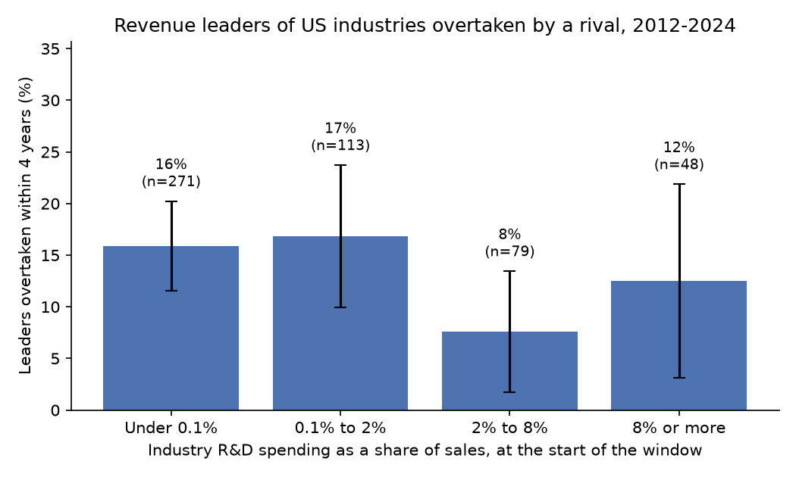
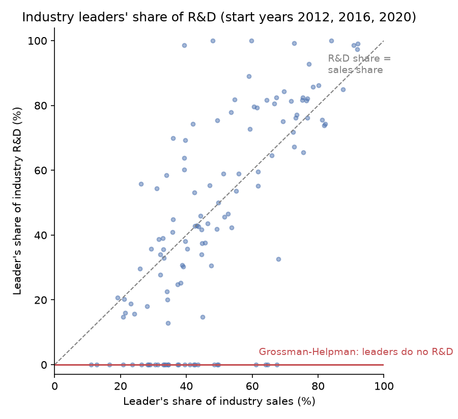

# Grossman and Helpman (1991) on SEC filings: findings

## In plain English

Grossman and Helpman's quality-ladder model says industry leaders are knocked off by challengers who invent the
next, better product, so leaders should fall faster where more is spent on research, and leaders themselves should
do no research. Using the 10-K filings of US public companies for 2012, 2016, 2020 and 2024:

- **Research-heavy industries do not lose their leaders faster.** Microsoft (software), Apple (computers),
  Alphabet (computer services, Google in 2012) and Qualcomm (wireless chips) led their industries at the start of
  all three four-year windows. About one leader in seven was overtaken within four years (14.5%), and that rate is
  no higher where research and development (R&D) is a large share of sales.
- **Most changes at the top are not inventions.** Verizon passed AT&T after AT&T spun off WarnerMedia, Delta
  passed American as airlines recovered from the pandemic, and Ford and General Motors swapped places. The model
  predicts almost no turnover in industries with R&D under 0.1% of sales (most report none), yet 15.9% of their
  leaders were overtaken.
- **The ladder does work sometimes.** Nvidia passed Intel in semiconductors (2020 to 2024) and Intuitive Surgical
  passed Zimmer Biomet in surgical appliances, each while spending a larger share of revenue on research than the
  leader it passed.
- **Leaders do a large share of the research.** In industries where R&D is at least 2% of sales, leaders made
  46.8% of sales and did 37.9% of R&D, far from the model's zero, though leaders are slightly less
  research-intensive than the rest of their industry (median 5.0% against 6.0% of sales).

A friendlier tour is in the [README](../README.md); methods and reproduction are in [TECHNICAL.md](../TECHNICAL.md).

**Key to the labels below.** *Window* = start year to end year of a four-year comparison. *Leader* = the company
with the most revenue in its four-digit SIC industry in the start year. *Overtaken* = the leader still reports at
the end and a rival that also reported at the start has more revenue. *Overtaken by any firm* = the same, but the
rival may be absent at the start. *Lost lead* = overtaken by any firm, or the leader stopped reporting. *Top-4
churn* = share of the start-year top four missing from the end-year top four. *R&D intensity* (s) = R&D expense
divided by revenue. *Hazard* = $`-\ln(1-p)/4`$, the annual rate implied by a four-year share $`p`$; expected tenure
is its inverse. *R&D groups* are by industry R&D intensity at the window start; "Under 0.1%" includes the 208
windows with no reported R&D. *Research industries* = R&D intensity of at least 2%. Coefficients are per percentage
point of R&D intensity; standard errors are clustered by industry.

## Sample

10,948 company-years from 4,823 companies with US addresses, at least $10 million of revenue, outside finance and
shell codes, in 376 SIC industries. Industries with at least five companies at a window start give 511 industry
windows in 196 industries: 180 for 2012-2016, 174 for 2016-2020 and 157 for 2020-2024.

## Industry windows by period (`industry_windows.csv`)

`industry_windows.csv` holds one row per industry window with every variable used in the tests (511 rows). Its
totals by window:

| Window | Industry windows | Industries | Median firms | Leaders overtaken | Overtaken % | Overtaken by any firm % | Lost lead % | Top-4 churn % | Leaders no longer reporting |
|---|---|---|---|---|---|---|---|---|---|
| 2012-2016 | 180 | 180 | 9 | 20 | 11.11 | 16.11 | 32.78 | 29.17 | 30 |
| 2016-2020 | 174 | 174 | 9 | 26 | 14.94 | 20.69 | 28.16 | 26.72 | 13 |
| 2020-2024 | 157 | 157 | 9 | 28 | 17.83 | 19.75 | 24.84 | 19.43 | 8 |
| All | 511 | 196 | 9 | 74 | 14.48 | 18.79 | 28.77 | 25.34 | 51 |

*Leaders no longer reporting* = start-year leaders with no filing in the end year (acquired, gone
private, or under a new SEC identity).

## Displacement by R&D intensity (`displacement_by_rd.csv`)

| R&D group | Industry windows | Windows with zero R&D | Median R&D % | Overtaken % | SE | Lost lead % | Top-4 churn % | Annual hazard % | Expected tenure, years | Median firms |
|---|---|---|---|---|---|---|---|---|---|---|
| Under 0.1% | 271 | 208 | 0.00 | 15.87 | 2.22 | 26.94 | 24.63 | 4.32 | 23.2 | 7 |
| 0.1% to 2% | 113 | 0 | 0.48 | 16.81 | 3.52 | 33.63 | 26.33 | 4.60 | 21.7 | 10 |
| 2% to 8% | 79 | 0 | 3.84 | 7.59 | 2.98 | 27.85 | 24.68 | 1.97 | 50.6 | 9 |
| 8% or more | 48 | 0 | 13.36 | 12.50 | 4.77 | 29.17 | 28.12 | 3.34 | 30.0 | 16.5 |
| All | 511 | 208 | 0.04 | 14.48 | 1.56 | 28.77 | 25.34 | 3.91 | 25.6 | 9 |

*SE* = binomial standard error of the overtaken share, in percentage points. *Median firms* = median
number of companies per industry window at the start.

Error bars are ±1.96 binomial standard errors, which ignore the repeated appearance of industries across windows.

## Regressions (`regressions.csv`)

| Specification | Coefficient | SE | 95% CI | p | One-sided p (H1: β > 0) | N | Industries | Mean outcome | Coef. on ln N | p (ln N) |
|---|---|---|---|---|---|---|---|---|---|---|
| Overtaken (main) | -0.0068 | 0.0049 | [-0.0165, 0.0029] | 0.17 | 0.91 | 511 | 196 | 0.145 | 0.058 | 0.052 |
| Overtaken, no controls | -0.0027 | 0.0043 | [-0.0112, 0.0057] | 0.53 | 0.74 | 511 | 196 | 0.145 |  |  |
| Overtaken by any firm, incl. new arrivals | -0.0037 | 0.0054 | [-0.0143, 0.0069] | 0.49 | 0.75 | 511 | 196 | 0.188 | 0.046 | 0.16 |
| Lost lead (exits count) | -0.0017 | 0.0057 | [-0.0129, 0.0094] | 0.76 | 0.62 | 511 | 196 | 0.288 | 0.035 | 0.32 |
| Top-4 churn | 0.0003 | 0.0024 | [-0.0044, 0.0051] | 0.89 | 0.44 | 511 | 196 | 0.253 | 0.022 | 0.26 |
| Overtaken, lead-ratio control | -0.0028 | 0.0044 | [-0.0115, 0.0058] | 0.53 | 0.74 | 511 | 196 | 0.145 | 0.032 | 0.28 |
| Overtaken, 2-digit SIC fixed effects | -0.0017 | 0.0060 | [-0.0136, 0.0101] | 0.77 | 0.61 | 511 | 196 | 0.145 | 0.075 | 0.034 |
| Overtaken, leader still reporting | -0.0071 | 0.0053 | [-0.0174, 0.0033] | 0.18 | 0.91 | 460 | 189 | 0.161 | 0.060 | 0.055 |
| Overtaken, industries reporting R&D | -0.0053 | 0.0053 | [-0.0157, 0.0050] | 0.31 | 0.84 | 303 | 123 | 0.142 | 0.036 | 0.26 |
| Overtaken, without 2020-2024 window | -0.0054 | 0.0072 | [-0.0195, 0.0087] | 0.45 | 0.77 | 354 | 191 | 0.130 | 0.041 | 0.27 |
| Overtaken, logit (average marginal effect) | -0.0069 | 0.0057 | [-0.0181, 0.0044] | 0.23 | 0.88 | 511 | 196 | 0.145 |  |  |

*Coefficient* = change in the probability of the outcome per percentage point of industry R&D intensity, from a
linear probability model with window fixed effects (the logit row reports the average marginal effect).
*Industries* = number of clusters. *Mean outcome* = share of windows with the outcome. *Coef. on ln N* = coefficient
on the log number of companies at the start; blank where that control is left out.

## Model-implied against observed displacement (`implied_hazard.csv`)

Implied hazard $`\iota = \rho s/(m - s)`$ at the group's median R&D intensity $`s`$ and median gross margin $`m`$,
with discount rate $`\rho`$.

| R&D group | Median s % | Median margin % | Implied hazard %, ρ = 2% | ρ = 4% | ρ = 8% | Observed hazard % |
|---|---|---|---|---|---|---|
| Under 0.1% | 0.00 | 31.8 | 0.00 | 0.00 | 0.00 | 4.32 |
| 0.1% to 2% | 0.48 | 34.0 | 0.03 | 0.06 | 0.11 | 4.60 |
| 2% to 8% | 3.84 | 38.4 | 0.22 | 0.44 | 0.89 | 1.97 |
| 8% or more | 13.36 | 52.0 | 0.69 | 1.38 | 2.76 | 3.34 |

Implied and observed four-year displacement, and the implied slope (implied four-year points per point of R&D
intensity, against zero at s = 0):

| R&D group | Implied 4-year %, ρ = 2% | ρ = 4% | ρ = 8% | Observed 4-year % | Slope, ρ = 2% | ρ = 4% | ρ = 8% |
|---|---|---|---|---|---|---|---|
| Under 0.1% | 0.00 | 0.00 | 0.00 | 15.87 |  |  |  |
| 0.1% to 2% | 0.11 | 0.23 | 0.45 | 16.81 | 0.24 | 0.48 | 0.95 |
| 2% to 8% | 0.88 | 1.76 | 3.49 | 7.59 | 0.23 | 0.46 | 0.91 |
| 8% or more | 2.73 | 5.38 | 10.47 | 12.50 | 0.20 | 0.40 | 0.78 |

The slope is blank for the lowest group, whose median R&D intensity is zero.

## Extension: do leaders do research? (`leader_research.csv`)

| Statistic | Value |
|---|---|
| Research-industry windows (industries) | 127 (55) |
| Leaders' share of sales, aggregate | 46.8% |
| Leaders' share of R&D, aggregate | 37.9% |
| Same, dropping the 30 leaders with no R&D under the standard tags (97 windows) | 50.1% of sales, 40.7% of R&D |
| Median leader share of sales / of R&D | 44.6% / 42.4% |
| Leaders reporting zero R&D | 23.6% |
| Leader's R&D share above its sales share | 42.5% of windows |
| Leader more research-intensive than the rest of its industry | 42.5% of windows |
| Median R&D intensity, leader / rest of industry | 5.05% / 5.97% |
| Wilcoxon signed-rank p, leader vs rest | 0.019 |
| Protection regression: coefficient on leader's relative intensity (SE), 95% CI, p, N | -0.0040 (0.0032), [-0.0103, 0.0023], 0.22, 127 |
| Research-industry leaders overtaken | 12 |
| Challenger more research-intensive than the leader it passed | 50% |
| Challenger's median revenue rank at the start | 2 |

*Aggregate* shares pool sales and R&D across all research-industry windows. *Rest of industry* = pooled R&D
intensity of every other company in the industry. *Protection regression* = overtaken on the leader's R&D
intensity minus the industry's, per percentage point.

## Named industries (`named_industries.csv`)

| Industry | SIC | Window | Firms | R&D intensity % | Leader | Leader revenue $bn | Leader R&D $bn | Leader R&D intensity % | Leader share of R&D % | End leader | End leader revenue $bn | Overtaken | Lost lead | Top-4 churn % |
|---|---|---|---|---|---|---|---|---|---|---|---|---|---|---|
| Biological products | 2836 | 2020-2024 | 55 | 28.4 | AMGEN INC | 25.4 | 4.2 | 16.5 | 20.0 | AMGEN INC | 33.4 | No | No | 25 |
| Biological products | 2836 | 2012-2016 | 27 | 20.9 | AMGEN INC | 17.3 | 3.4 | 19.6 | 41.8 | GILEAD SCIENCES, INC. | 30.4 | Yes | Yes | 25 |
| Pharmaceutical preparations | 2834 | 2020-2024 | 166 | 20.9 | JOHNSON & JOHNSON | 82.6 | 12.2 | 14.7 | 14.7 | JOHNSON & JOHNSON | 88.8 | No | No | 25 |
| Biological products | 2836 | 2016-2020 | 32 | 20.0 | GILEAD SCIENCES, INC. | 30.4 | 5.1 | 16.8 | 37.5 | AMGEN INC | 25.4 | Yes | Yes | 25 |
| Pharmaceutical preparations | 2834 | 2016-2020 | 120 | 19.4 | JOHNSON & JOHNSON | 71.9 | 9.1 | 12.7 | 15.7 | JOHNSON & JOHNSON | 82.6 | No | No | 25 |
| Semiconductors | 3674 | 2012-2016 | 103 | 17.6 | INTEL CORP | 53.3 | 10.1 | 19.0 | 35.6 | INTEL CORP | 59.4 | No | No | 0 |
| Semiconductors | 3674 | 2016-2020 | 73 | 17.2 | INTEL CORP | 59.4 | 12.7 | 21.5 | 44.9 | INTEL CORP | 77.9 | No | No | 25 |
| Computer services | 7370 | 2020-2024 | 32 | 16.9 | ALPHABET INC. | 182.5 | 27.6 | 15.1 | 55.2 | ALPHABET INC. | 350.0 | No | No | 50 |
| Radio and TV broadcasting equipment | 3663 | 2020-2024 | 20 | 16.6 | QUALCOMM INC/DE | 23.5 | 6.0 | 25.4 | 75.3 | QUALCOMM INC/DE | 39.0 | No | No | 0 |
| Semiconductors | 3674 | 2020-2024 | 64 | 16.4 | INTEL CORP | 77.9 | 13.6 | 17.4 | 34.1 | NVIDIA CORP | 130.5 | Yes | Yes | 25 |
| Prepackaged software | 7372 | 2016-2020 | 109 | 16.3 | MICROSOFT CORP | 90.0 | 13.0 | 14.5 | 35.7 | MICROSOFT CORP | 168.1 | No | No | 25 |
| Prepackaged software | 7372 | 2020-2024 | 135 | 16.1 | MICROSOFT CORP | 168.1 | 20.7 | 12.3 | 34.1 | MICROSOFT CORP | 281.7 | No | No | 25 |
| Computer services | 7370 | 2016-2020 | 25 | 15.8 | ALPHABET INC. | 90.3 | 13.9 | 15.5 | 64.6 | ALPHABET INC. | 182.5 | No | No | 50 |
| Pharmaceutical preparations | 2834 | 2012-2016 | 104 | 15.3 | JOHNSON & JOHNSON | 67.2 | 7.7 | 11.4 | 16.0 | JOHNSON & JOHNSON | 71.9 | No | No | 25 |
| Prepackaged software | 7372 | 2012-2016 | 110 | 13.9 | MICROSOFT CORP | 77.8 | 10.4 | 13.4 | 38.0 | MICROSOFT CORP | 90.0 | No | No | 50 |
| Computer storage devices | 3572 | 2016-2020 | 6 | 13.8 | WESTERN DIGITAL CORP | 19.1 | 2.4 | 12.8 | 67.3 | WESTERN DIGITAL CORP | 16.9 | No | No | 0 |
| Computer services | 7370 | 2012-2016 | 25 | 13.0 | GOOGLE INC. | 50.2 | 6.8 | 13.5 | 76.2 | META PLATFORMS, INC. | 27.6 | No | Yes | 50 |
| Radio and TV broadcasting equipment | 3663 | 2016-2020 | 18 | 12.3 | QUALCOMM INC/DE | 23.6 | 5.2 | 21.9 | 74.2 | QUALCOMM INC/DE | 23.5 | No | No | 50 |
| Computer storage devices | 3572 | 2012-2016 | 11 | 11.9 | EMC CORP | 21.7 | 2.6 | 11.8 | 43.0 | WESTERN DIGITAL CORP | 19.1 | No | Yes | 50 |
| Radio and TV broadcasting equipment | 3663 | 2012-2016 | 25 | 11.7 | QUALCOMM INC/DE | 19.1 | 3.9 | 20.5 | 69.3 | QUALCOMM INC/DE | 23.6 | No | No | 50 |
| Electromedical apparatus | 3845 | 2012-2016 | 30 | 9.7 | MEDTRONIC INC | 16.6 | 1.6 | 9.4 | 53.6 | VARIAN MEDICAL SYSTEMS INC | 2.6 | No | Yes | 50 |
| Electromedical apparatus | 3845 | 2020-2024 | 21 | 9.1 | MASIMO CORP | 1.1 | 0.1 | 10.4 | 29.6 | MASIMO CORP | 2.1 | No | No | 25 |
| Computer processing and data | 7374 | 2020-2024 | 42 | 7.7 | DXC TECHNOLOGY CO | 17.7 | 0.0 | 0.0 | 0.0 | AUTOMATIC DATA PROCESSING INC | 20.6 | Yes | Yes | 25 |
| Computer processing and data | 7374 | 2016-2020 | 38 | 7.4 | AUTOMATIC DATA PROCESSING INC | 12.4 | 0.0 | 0.0 | 0.0 | AUTOMATIC DATA PROCESSING INC | 15.0 | No | Yes | 50 |
| Electronic computers | 3571 | 2020-2024 | 6 | 6.5 | APPLE INC | 274.5 | 18.8 | 6.8 | 77.1 | APPLE INC | 391.0 | No | No | 0 |
| Electromedical apparatus | 3845 | 2016-2020 | 23 | 6.4 | VARIAN MEDICAL SYSTEMS INC | 2.6 | 0.2 | 7.6 | 39.0 | MASIMO CORP | 1.1 | No | Yes | 25 |
| Surgical and medical instruments | 3841 | 2020-2024 | 76 | 5.7 | 3M CO | 32.2 | 0.0 | 0.0 | 0.0 | 3M CO | 24.6 | No | No | 25 |
| Surgical and medical instruments | 3841 | 2016-2020 | 74 | 5.2 | 3M CO | 30.1 | 0.0 | 0.0 | 0.0 | 3M CO | 32.2 | No | No | 0 |
| Surgical and medical instruments | 3841 | 2012-2016 | 62 | 5.0 | 3M CO | 29.9 | 0.0 | 0.0 | 0.0 | 3M CO | 30.1 | No | No | 0 |
| Computer processing and data | 7374 | 2012-2016 | 31 | 4.9 | AUTOMATIC DATA PROCESSING INC | 11.3 | 0.0 | 0.0 | 0.0 | AUTOMATIC DATA PROCESSING INC | 12.4 | No | No | 50 |
| Electronic computers | 3571 | 2016-2020 | 7 | 4.7 | APPLE INC | 215.6 | 10.0 | 4.7 | 76.2 | APPLE INC | 274.5 | No | No | 25 |
| Electronic computers | 3571 | 2012-2016 | 9 | 2.2 | APPLE INC | 156.5 | 3.4 | 2.2 | 71.8 | APPLE INC | 215.6 | No | No | 75 |
| Motor vehicles | 3711 | 2012-2016 | 10 | 0.8 | GENERAL MOTORS CO | 152.3 | 0.0 | 0.0 | 0.0 | GENERAL MOTORS CO | 166.4 | No | No | 50 |
| Motor vehicle parts | 3714 | 2020-2024 | 28 | 0.7 | LEAR CORP | 17.0 | 0.0 | 0.0 | 0.0 | LEAR CORP | 23.3 | No | No | 25 |
| Motor vehicles | 3711 | 2020-2024 | 10 | 0.5 | FORD MOTOR CO | 127.1 | 0.0 | 0.0 | 0.0 | GENERAL MOTORS CO | 187.4 | Yes | Yes | 0 |
| Motor vehicle parts | 3714 | 2016-2020 | 30 | 0.4 | LEAR CORP | 18.6 | 0.0 | 0.0 | 0.0 | LEAR CORP | 17.0 | No | No | 25 |
| Motor vehicle parts | 3714 | 2012-2016 | 32 | 0.4 | TRW AUTOMOTIVE HOLDINGS CORP | 16.4 | 0.0 | 0.0 | 0.0 | LEAR CORP | 18.6 | No | Yes | 25 |
| Motor vehicles | 3711 | 2016-2020 | 10 | 0.4 | GENERAL MOTORS CO | 166.4 | 0.0 | 0.0 | 0.0 | FORD MOTOR CO | 127.1 | Yes | Yes | 25 |
| Catalog and mail-order | 5961 | 2020-2024 | 14 | 0.1 | AMAZON COM INC | 386.1 | 0.0 | 0.0 | 0.0 | AMAZON COM INC | 638.0 | No | No | 50 |
| Telephone communications | 4813 | 2020-2024 | 20 | 0.0 | AT&T INC. | 171.8 | 0.0 | 0.0 | 0.0 | VERIZON COMMUNICATIONS INC | 134.8 | Yes | Yes | 0 |
| Telephone communications | 4813 | 2012-2016 | 39 | 0.0 | AT&T INC. | 127.4 | 0.0 | 0.0 | 0.0 | AT&T INC. | 163.8 | No | No | 0 |
| Telephone communications | 4813 | 2016-2020 | 28 | 0.0 | AT&T INC. | 163.8 | 0.0 | 0.0 | 0.0 | AT&T INC. | 171.8 | No | No | 25 |
| Beverages | 2080 | 2012-2016 | 10 | 0.0 | PEPSICO INC | 65.5 | 0.0 | 0.0 |  | PEPSICO INC | 62.8 | No | No | 25 |
| Petroleum refining | 2911 | 2012-2016 | 12 | 0.0 | CHEVRON CORP | 241.9 | 0.0 | 0.0 |  | CHEVRON CORP | 114.5 | No | No | 25 |
| Scheduled air transport | 4512 | 2012-2016 | 14 | 0.0 | UNITED AIRLINES HOLDINGS, INC. | 37.2 | 0.0 | 0.0 |  | AMERICAN AIRLINES GROUP INC. | 40.2 | Yes | Yes | 25 |
| Variety stores | 5331 | 2012-2016 | 13 | 0.0 | WALMART INC. | 469.2 | 0.0 | 0.0 |  | WALMART INC. | 485.9 | No | No | 0 |
| Grocery stores | 5411 | 2012-2016 | 13 | 0.0 | KROGER CO | 96.8 | 0.0 | 0.0 |  | KROGER CO | 115.3 | No | No | 25 |
| Catalog and mail-order | 5961 | 2012-2016 | 13 | 0.0 | AMAZON COM INC | 61.1 | 0.0 | 0.0 |  | AMAZON COM INC | 136.0 | No | No | 0 |
| Beverages | 2080 | 2016-2020 | 11 | 0.0 | PEPSICO INC | 62.8 | 0.0 | 0.0 |  | PEPSICO INC | 70.4 | No | No | 0 |
| Petroleum refining | 2911 | 2016-2020 | 10 | 0.0 | CHEVRON CORP | 114.5 | 0.0 | 0.0 |  | CHEVRON CORP | 94.7 | No | Yes | 75 |
| Scheduled air transport | 4512 | 2016-2020 | 10 | 0.0 | AMERICAN AIRLINES GROUP INC. | 40.2 | 0.0 | 0.0 |  | AMERICAN AIRLINES GROUP INC. | 17.3 | No | No | 0 |
| Variety stores | 5331 | 2016-2020 | 12 | 0.0 | WALMART INC. | 485.9 | 0.0 | 0.0 |  | WALMART INC. | 559.2 | No | No | 0 |
| Grocery stores | 5411 | 2016-2020 | 11 | 0.0 | KROGER CO | 115.3 | 0.0 | 0.0 |  | KROGER CO | 132.5 | No | No | 50 |
| Catalog and mail-order | 5961 | 2016-2020 | 12 | 0.0 | AMAZON COM INC | 136.0 | 0.0 | 0.0 |  | AMAZON COM INC | 386.1 | No | No | 25 |
| Beverages | 2080 | 2020-2024 | 13 | 0.0 | PEPSICO INC | 70.4 | 0.0 | 0.0 |  | PEPSICO INC | 91.9 | No | No | 0 |
| Petroleum refining | 2911 | 2020-2024 | 16 | 0.0 | EXXON MOBIL CORP | 181.5 | 0.0 | 0.0 |  | EXXON MOBIL CORP | 349.6 | No | No | 25 |
| Scheduled air transport | 4512 | 2020-2024 | 11 | 0.0 | AMERICAN AIRLINES GROUP INC. | 17.3 | 0.0 | 0.0 |  | DELTA AIR LINES, INC. | 61.6 | Yes | Yes | 0 |
| Variety stores | 5331 | 2020-2024 | 12 | 0.0 | WALMART INC. | 559.2 | 0.0 | 0.0 |  | WALMART INC. | 681.0 | No | No | 0 |
| Grocery stores | 5411 | 2020-2024 | 9 | 0.0 | KROGER CO | 132.5 | 0.0 | 0.0 |  | KROGER CO | 147.1 | No | No | 0 |

Revenue and R&D in $ billions at the start year except *End leader revenue*, which is the end year. *End leader* =
the largest company in the industry at the end among those present at the start. A blank leader share of R&D
means no company in the industry reported R&D. Company names are as filed with the SEC.

## Research industries, every window (`research_industries.csv`)

| Window | SIC | Firms | R&D intensity % | Leader | Leader share of sales % | Leader R&D intensity % | Rest R&D intensity % | Leader share of R&D % | Overtaken | End leader |
|---|---|---|---|---|---|---|---|---|---|---|
| 2012-2016 | 1040 | 7 | 3.0 | NEWMONT CORP /DE/ | 84.0 | 3.5 | 0.0 | 100.0 | No | NEWMONT CORP /DE/ |
| 2012-2016 | 1400 | 11 | 9.2 | MDU RESOURCES GROUP INC | 28.5 | 0.0 | 12.8 | 0.0 | No | MDU RESOURCES GROUP INC |
| 2012-2016 | 2821 | 10 | 2.5 | DOW CHEMICAL CO /DE/ | 67.4 | 3.0 | 1.3 | 82.4 | No | DOW CHEMICAL CO /DE/ |
| 2012-2016 | 2834 | 104 | 15.3 | JOHNSON & JOHNSON | 21.5 | 11.4 | 16.3 | 16.0 | No | JOHNSON & JOHNSON |
| 2012-2016 | 2835 | 11 | 7.6 | ALERE INC. | 49.3 | 6.5 | 8.7 | 41.9 | No | ALERE INC. |
| 2012-2016 | 2836 | 27 | 20.9 | AMGEN INC | 44.7 | 19.6 | 22.0 | 41.8 | Yes | GILEAD SCIENCES, INC. |
| 2012-2016 | 2851 | 5 | 2.3 | PPG INDUSTRIES INC | 60.5 | 3.0 | 1.2 | 79.6 | No | PPG INDUSTRIES INC |
| 2012-2016 | 2860 | 29 | 3.2 | WESTLAKE CORP | 16.6 | 0.0 | 3.8 | 0.0 | No | WESTLAKE CORP |
| 2012-2016 | 2870 | 9 | 4.5 | MONSANTO CO /NEW/ | 39.3 | 11.2 | 0.1 | 98.6 | No | MONSANTO CO /NEW/ |
| 2012-2016 | 3510 | 7 | 3.4 | CUMMINS INC | 59.2 | 4.2 | 2.3 | 72.8 | No | CUMMINS INC |
| 2012-2016 | 3523 | 5 | 3.7 | DEERE & CO | 76.4 | 4.0 | 2.9 | 81.4 | No | DEERE & CO |
| 2012-2016 | 3531 | 6 | 3.5 | CATERPILLAR INC | 92.1 | 3.7 | 0.4 | 99.1 | No | CATERPILLAR INC |
| 2012-2016 | 3559 | 17 | 18.0 | LAM RESEARCH CORP | 55.9 | 19.0 | 16.8 | 59.0 | No | LAM RESEARCH CORP |
| 2012-2016 | 3564 | 6 | 2.2 | DONALDSON CO INC | 80.2 | 2.4 | 1.6 | 86.1 | No | DONALDSON CO INC |
| 2012-2016 | 3571 | 9 | 2.2 | APPLE INC | 72.4 | 2.2 | 2.2 | 71.8 | No | APPLE INC |
| 2012-2016 | 3572 | 11 | 11.9 | EMC CORP | 43.2 | 11.8 | 11.9 | 43.0 | No | WESTERN DIGITAL CORP |
| 2012-2016 | 3576 | 16 | 13.2 | CISCO SYSTEMS, INC. | 81.8 | 11.9 | 18.9 | 73.9 | No | CISCO SYSTEMS, INC. |
| 2012-2016 | 3577 | 15 | 13.2 | BROCADE COMMUNICATIONS SYSTEMS INC | 31.5 | 16.2 | 11.8 | 38.7 | No | LOGITECH INTERNATIONAL S.A. |
| 2012-2016 | 3578 | 6 | 4.3 | NCR VOYIX CORP | 52.7 | 3.8 | 4.9 | 46.5 | No | NCR VOYIX CORP |
| 2012-2016 | 3620 | 6 | 5.3 | WOODWARD, INC. | 53.6 | 7.7 | 2.5 | 77.9 | No | WOODWARD, INC. |
| 2012-2016 | 3661 | 21 | 13.5 | AVAYA INC | 37.4 | 9.0 | 16.2 | 24.8 | No | CIENA CORP |
| 2012-2016 | 3663 | 25 | 11.7 | QUALCOMM INC/DE | 39.7 | 20.5 | 6.0 | 69.3 | No | QUALCOMM INC/DE |
| 2012-2016 | 3669 | 18 | 2.5 | EXELIS INC. | 67.9 | 1.2 | 5.3 | 32.6 | No | ESCO TECHNOLOGIES INC |
| 2012-2016 | 3670 | 12 | 2.1 | HUBBELL INC | 34.5 | 0.0 | 3.2 | 0.0 | No | HUBBELL INC |
| 2012-2016 | 3674 | 103 | 17.6 | INTEL CORP | 32.9 | 19.0 | 16.9 | 35.6 | No | INTEL CORP |
| 2012-2016 | 3679 | 15 | 4.3 | POWER ONE INC | 33.3 | 0.0 | 6.4 | 0.0 | No | ADVANCED ENERGY INDUSTRIES INC |
| 2012-2016 | 3724 | 5 | 2.5 | RTX CORP | 59.8 | 4.1 | 0.0 | 100.0 | No | RTX CORP |
| 2012-2016 | 3823 | 11 | 4.9 | DANAHER CORP /DE/ | 64.4 | 6.2 | 2.5 | 81.7 | No | DANAHER CORP /DE/ |
| 2012-2016 | 3825 | 15 | 12.4 | ITRON, INC. | 38.3 | 8.2 | 15.0 | 25.3 | No | ITRON, INC. |
| 2012-2016 | 3826 | 16 | 9.8 | AGILENT TECHNOLOGIES, INC. | 33.1 | 9.7 | 9.8 | 32.9 | No | AGILENT TECHNOLOGIES, INC. |
| 2012-2016 | 3827 | 7 | 14.3 | KLA CORP | 77.1 | 17.2 | 4.5 | 92.7 | No | KLA CORP |
| 2012-2016 | 3829 | 17 | 3.4 | THERMO FISHER SCIENTIFIC INC. | 51.5 | 3.0 | 3.8 | 45.6 | No | THERMO FISHER SCIENTIFIC INC. |
| 2012-2016 | 3841 | 62 | 5.0 | 3M CO | 33.8 | 0.0 | 7.5 | 0.0 | No | 3M CO |
| 2012-2016 | 3842 | 21 | 4.6 | ZIMMER BIOMET HOLDINGS, INC. | 19.1 | 5.0 | 4.6 | 20.7 | No | ZIMMER BIOMET HOLDINGS, INC. |
| 2012-2016 | 3845 | 30 | 9.7 | MEDTRONIC INC | 55.1 | 9.4 | 10.0 | 53.6 | No | VARIAN MEDICAL SYSTEMS INC |
| 2012-2016 | 3990 | 12 | 4.7 | INTERNATIONAL GAME TECHNOLOGY | 26.1 | 10.1 | 2.8 | 55.8 | No | HILLENBRAND, INC. |
| 2012-2016 | 7370 | 25 | 13.0 | GOOGLE INC. | 73.2 | 13.5 | 11.6 | 76.2 | No | META PLATFORMS, INC. |
| 2012-2016 | 7371 | 26 | 3.1 | COGNIZANT TECHNOLOGY SOLUTIONS CORP | 48.5 | 0.0 | 6.0 | 0.0 | No | COGNIZANT TECHNOLOGY SOLUTIONS CORP |
| 2012-2016 | 7372 | 110 | 13.9 | MICROSOFT CORP | 39.6 | 13.4 | 14.3 | 38.0 | No | MICROSOFT CORP |
| 2012-2016 | 7373 | 39 | 4.2 | COMPUTER SCIENCES CORP | 26.4 | 0.0 | 5.7 | 0.0 | No | COMPUTER SCIENCES CORP |
| 2012-2016 | 7374 | 31 | 4.9 | AUTOMATIC DATA PROCESSING INC | 43.6 | 0.0 | 8.8 | 0.0 | No | AUTOMATIC DATA PROCESSING INC |
| 2012-2016 | 8731 | 11 | 4.4 | COVANCE INC | 37.7 | 0.0 | 7.0 | 0.0 | No | PAREXEL INTERNATIONAL CORP |
| 2016-2020 | 1382 | 5 | 2.6 | SAEXPLORATION HOLDINGS, INC. | 30.5 | 0.0 | 3.8 | 0.0 | No | ION GEOPHYSICAL CORP |
| 2016-2020 | 2821 | 11 | 2.5 | DOW CHEMICAL CO /DE/ | 61.4 | 3.3 | 1.4 | 79.3 | No | EASTMAN CHEMICAL CO |
| 2016-2020 | 2834 | 120 | 19.4 | JOHNSON & JOHNSON | 24.1 | 12.7 | 21.6 | 15.7 | No | JOHNSON & JOHNSON |
| 2016-2020 | 2835 | 9 | 6.0 | ALERE INC. | 38.8 | 4.7 | 6.7 | 30.7 | No | IDEXX LABORATORIES INC /DE |
| 2016-2020 | 2836 | 32 | 20.0 | GILEAD SCIENCES, INC. | 44.7 | 16.8 | 22.6 | 37.5 | Yes | AMGEN INC |
| 2016-2020 | 2851 | 5 | 2.1 | PPG INDUSTRIES INC | 58.9 | 3.2 | 0.6 | 89.0 | No | PPG INDUSTRIES INC |
| 2016-2020 | 2870 | 9 | 5.4 | MONSANTO CO /NEW/ | 48.0 | 11.2 | 0.0 | 100.0 | No | MOSAIC CO |
| 2016-2020 | 2890 | 7 | 2.5 | ELEMENT SOLUTIONS INC | 46.5 | 2.4 | 2.6 | 43.6 | Yes | CABOT CORP |
| 2016-2020 | 3510 | 8 | 3.0 | CUMMINS INC | 66.8 | 3.6 | 1.8 | 80.6 | No | CUMMINS INC |
| 2016-2020 | 3523 | 5 | 4.8 | DEERE & CO | 75.2 | 5.2 | 3.5 | 81.7 | No | DEERE & CO |
| 2016-2020 | 3531 | 6 | 4.7 | CATERPILLAR INC | 90.8 | 5.1 | 0.7 | 98.7 | No | CATERPILLAR INC |
| 2016-2020 | 3533 | 10 | 2.0 | BAKER HUGHES HOLDINGS LLC | 35.9 | 3.9 | 0.9 | 70.0 | No | BAKER HUGHES HOLDINGS LLC |
| 2016-2020 | 3559 | 13 | 11.4 | LAM RESEARCH CORP | 71.7 | 12.9 | 7.5 | 81.4 | No | LAM RESEARCH CORP |
| 2016-2020 | 3564 | 5 | 2.3 | DONALDSON CO INC | 78.5 | 2.5 | 1.5 | 85.8 | No | DONALDSON CO INC |
| 2016-2020 | 3571 | 7 | 4.7 | APPLE INC | 76.8 | 4.7 | 4.8 | 76.2 | No | APPLE INC |
| 2016-2020 | 3572 | 6 | 13.8 | WESTERN DIGITAL CORP | 72.7 | 12.8 | 16.5 | 67.3 | No | WESTERN DIGITAL CORP |
| 2016-2020 | 3576 | 12 | 13.8 | CISCO SYSTEMS, INC. | 81.2 | 12.8 | 18.0 | 75.5 | No | CISCO SYSTEMS, INC. |
| 2016-2020 | 3577 | 12 | 15.7 | LOGITECH INTERNATIONAL S.A. | 34.3 | 5.9 | 20.8 | 12.9 | No | LOGITECH INTERNATIONAL S.A. |
| 2016-2020 | 3578 | 5 | 4.7 | NCR VOYIX CORP | 53.7 | 3.7 | 5.8 | 42.4 | No | NCR VOYIX CORP |
| 2016-2020 | 3620 | 5 | 5.8 | WOODWARD, INC. | 69.3 | 6.2 | 4.7 | 75.0 | No | WOODWARD, INC. |
| 2016-2020 | 3651 | 5 | 7.8 | KNOWLES CORP | 54.7 | 11.7 | 3.1 | 81.9 | No | KNOWLES CORP |
| 2016-2020 | 3661 | 14 | 15.2 | CIENA CORP | 35.8 | 17.4 | 14.0 | 40.9 | No | CIENA CORP |
| 2016-2020 | 3663 | 18 | 12.3 | QUALCOMM INC/DE | 41.9 | 21.9 | 5.5 | 74.2 | No | QUALCOMM INC/DE |
| 2016-2020 | 3669 | 14 | 8.6 | LUMENTUM HOLDINGS INC. | 34.0 | 14.8 | 5.4 | 58.4 | No | LUMENTUM HOLDINGS INC. |
| 2016-2020 | 3674 | 73 | 17.2 | INTEL CORP | 35.9 | 21.5 | 14.8 | 44.9 | No | INTEL CORP |
| 2016-2020 | 3679 | 8 | 11.1 | VAREX IMAGING CORP | 39.0 | 8.6 | 12.7 | 30.2 | Yes | ADVANCED ENERGY INDUSTRIES INC |
| 2016-2020 | 3823 | 13 | 5.6 | DANAHER CORP /DE/ | 44.3 | 5.8 | 5.4 | 46.0 | No | DANAHER CORP /DE/ |
| 2016-2020 | 3825 | 13 | 12.7 | ITRON, INC. | 34.1 | 8.4 | 14.9 | 22.5 | Yes | TERADYNE, INC |
| 2016-2020 | 3826 | 11 | 9.6 | AGILENT TECHNOLOGIES, INC. | 23.1 | 7.8 | 10.1 | 18.8 | No | AGILENT TECHNOLOGIES, INC. |
| 2016-2020 | 3827 | 5 | 13.8 | KLA CORP | 75.4 | 15.1 | 9.9 | 82.5 | No | KLA CORP |
| 2016-2020 | 3829 | 13 | 4.3 | THERMO FISHER SCIENTIFIC INC. | 61.8 | 4.1 | 4.5 | 59.5 | No | THERMO FISHER SCIENTIFIC INC. |
| 2016-2020 | 3841 | 74 | 5.2 | 3M CO | 31.3 | 0.0 | 7.6 | 0.0 | No | 3M CO |
| 2016-2020 | 3842 | 17 | 5.5 | ZIMMER BIOMET HOLDINGS, INC. | 32.0 | 4.8 | 5.9 | 27.7 | No | ZIMMER BIOMET HOLDINGS, INC. |
| 2016-2020 | 3845 | 23 | 6.4 | VARIAN MEDICAL SYSTEMS INC | 32.9 | 7.6 | 5.9 | 39.0 | No | MASIMO CORP |
| 2016-2020 | 3949 | 6 | 3.2 | ACUSHNET HOLDINGS CORP. | 43.7 | 3.1 | 3.2 | 42.6 | No | ACUSHNET HOLDINGS CORP. |
| 2016-2020 | 3990 | 7 | 2.2 | HILLENBRAND, INC. | 39.5 | 0.0 | 3.7 | 0.0 | No | HILLENBRAND, INC. |
| 2016-2020 | 7310 | 10 | 3.3 | CLEAR CHANNEL OUTDOOR HOLDINGS, INC. | 64.0 | 0.0 | 9.1 | 0.0 | No | CLEAR CHANNEL OUTDOOR HOLDINGS, INC. |
| 2016-2020 | 7370 | 25 | 15.8 | ALPHABET INC. | 65.9 | 15.5 | 16.4 | 64.6 | No | ALPHABET INC. |
| 2016-2020 | 7371 | 21 | 2.6 | COGNIZANT TECHNOLOGY SOLUTIONS CORP | 64.8 | 0.0 | 7.3 | 0.0 | No | COGNIZANT TECHNOLOGY SOLUTIONS CORP |
| 2016-2020 | 7372 | 109 | 16.3 | MICROSOFT CORP | 40.3 | 14.5 | 17.6 | 35.7 | No | MICROSOFT CORP |
| 2016-2020 | 7373 | 36 | 5.5 | COMPUTER SCIENCES CORP | 12.8 | 0.0 | 6.3 | 0.0 | No | LEIDOS HOLDINGS, INC. |
| 2016-2020 | 7374 | 38 | 7.4 | AUTOMATIC DATA PROCESSING INC | 42.5 | 0.0 | 12.9 | 0.0 | No | AUTOMATIC DATA PROCESSING INC |
| 2016-2020 | 8731 | 13 | 3.6 | IQVIA HOLDINGS INC. | 41.1 | 0.0 | 6.1 | 0.0 | No | IQVIA HOLDINGS INC. |
| 2020-2024 | 100 | 9 | 5.9 | CORTEVA, INC. | 72.8 | 8.0 | 0.2 | 99.3 | No | CORTEVA, INC. |
| 2020-2024 | 2800 | 11 | 2.3 | HUNTSMAN CORP | 21.1 | 2.2 | 2.4 | 20.2 | Yes | OLIN CORP |
| 2020-2024 | 2821 | 12 | 2.4 | DOW INC. | 45.7 | 2.0 | 2.8 | 37.7 | No | DOW INC. |
| 2020-2024 | 2834 | 166 | 20.9 | JOHNSON & JOHNSON | 20.9 | 14.7 | 22.5 | 14.7 | No | JOHNSON & JOHNSON |
| 2020-2024 | 2835 | 8 | 8.1 | IDEXX LABORATORIES INC /DE | 47.5 | 5.2 | 10.7 | 30.6 | No | IDEXX LABORATORIES INC /DE |
| 2020-2024 | 2836 | 55 | 28.4 | AMGEN INC | 34.3 | 16.5 | 34.5 | 20.0 | No | AMGEN INC |
| 2020-2024 | 2890 | 6 | 2.2 | CABOT CORP | 42.7 | 2.2 | 2.2 | 42.9 | No | CABOT CORP |
| 2020-2024 | 3480 | 6 | 3.1 | VISTA OUTDOOR INC. | 45.0 | 1.0 | 4.8 | 14.7 | No | AXON ENTERPRISE, INC. |
| 2020-2024 | 3510 | 7 | 3.8 | CUMMINS INC | 69.6 | 4.6 | 1.9 | 84.4 | No | CUMMINS INC |
| 2020-2024 | 3523 | 5 | 4.3 | DEERE & CO | 76.7 | 4.6 | 3.3 | 82.2 | No | DEERE & CO |
| 2020-2024 | 3531 | 6 | 3.2 | CATERPILLAR INC | 91.9 | 3.4 | 1.0 | 97.4 | No | CATERPILLAR INC |
| 2020-2024 | 3559 | 14 | 10.5 | LAM RESEARCH CORP | 87.6 | 10.2 | 12.8 | 85.0 | No | LAM RESEARCH CORP |
| 2020-2024 | 3561 | 7 | 2.2 | XYLEM INC. | 30.9 | 3.8 | 1.4 | 54.3 | No | XYLEM INC. |
| 2020-2024 | 3569 | 5 | 2.1 | REGAL REXNORD CORP | 42.3 | 0.0 | 3.7 | 0.0 | No | REGAL REXNORD CORP |
| 2020-2024 | 3571 | 6 | 6.5 | APPLE INC | 73.5 | 6.8 | 5.6 | 77.1 | No | APPLE INC |
| 2020-2024 | 3576 | 8 | 14.2 | CISCO SYSTEMS, INC. | 82.2 | 12.9 | 20.5 | 74.3 | No | CISCO SYSTEMS, INC. |
| 2020-2024 | 3577 | 11 | 7.9 | XEROX HOLDINGS CORP | 33.0 | 0.0 | 11.8 | 0.0 | Yes | PALO ALTO NETWORKS INC |
| 2020-2024 | 3620 | 6 | 4.6 | WOODWARD, INC. | 51.2 | 5.3 | 3.9 | 59.0 | No | WOODWARD, INC. |
| 2020-2024 | 3651 | 6 | 12.9 | SONOS INC | 42.4 | 16.2 | 10.5 | 53.2 | No | SONOS INC |
| 2020-2024 | 3661 | 15 | 12.3 | CIENA CORP | 29.2 | 15.0 | 11.2 | 35.7 | No | CIENA CORP |
| 2020-2024 | 3663 | 20 | 16.6 | QUALCOMM INC/DE | 49.4 | 25.4 | 8.1 | 75.3 | No | QUALCOMM INC/DE |
| 2020-2024 | 3669 | 14 | 8.1 | LUMENTUM HOLDINGS INC. | 39.4 | 12.3 | 5.3 | 60.2 | No | LUMENTUM HOLDINGS INC. |
| 2020-2024 | 3670 | 9 | 2.4 | HUBBELL INC | 49.4 | 0.0 | 4.8 | 0.0 | No | HUBBELL INC |
| 2020-2024 | 3674 | 64 | 16.4 | INTEL CORP | 32.0 | 17.4 | 15.9 | 34.1 | Yes | NVIDIA CORP |
| 2020-2024 | 3679 | 9 | 4.5 | VERTIV HOLDINGS CO | 61.2 | 0.0 | 11.7 | 0.0 | No | VERTIV HOLDINGS CO |
| 2020-2024 | 3823 | 11 | 6.0 | DANAHER CORP /DE/ | 49.7 | 6.0 | 6.0 | 50.0 | No | DANAHER CORP /DE/ |
| 2020-2024 | 3825 | 10 | 10.2 | TERADYNE, INC | 47.1 | 12.0 | 8.6 | 55.4 | No | TERADYNE, INC |
| 2020-2024 | 3826 | 17 | 8.3 | AVANTOR, INC. | 20.8 | 0.0 | 10.4 | 0.0 | No | AVANTOR, INC. |
| 2020-2024 | 3829 | 7 | 4.2 | THERMO FISHER SCIENTIFIC INC. | 75.5 | 3.7 | 6.0 | 65.5 | No | THERMO FISHER SCIENTIFIC INC. |
| 2020-2024 | 3841 | 76 | 5.7 | 3M CO | 28.3 | 0.0 | 7.9 | 0.0 | No | 3M CO |
| 2020-2024 | 3842 | 17 | 8.2 | ZIMMER BIOMET HOLDINGS, INC. | 28.0 | 5.3 | 9.3 | 18.1 | Yes | INTUITIVE SURGICAL INC |
| 2020-2024 | 3845 | 21 | 9.1 | MASIMO CORP | 25.9 | 10.4 | 8.6 | 29.6 | No | MASIMO CORP |
| 2020-2024 | 3949 | 9 | 3.8 | PELOTON INTERACTIVE, INC. | 39.3 | 6.2 | 2.3 | 63.7 | Yes | TOPGOLF CALLAWAY BRANDS CORP. |
| 2020-2024 | 7310 | 9 | 2.3 | CLEAR CHANNEL OUTDOOR HOLDINGS, INC. | 34.4 | 0.0 | 3.5 | 0.0 | No | CLEAR CHANNEL OUTDOOR HOLDINGS, INC. |
| 2020-2024 | 7370 | 32 | 16.9 | ALPHABET INC. | 61.8 | 15.1 | 19.8 | 55.2 | No | ALPHABET INC. |
| 2020-2024 | 7371 | 18 | 2.4 | COGNIZANT TECHNOLOGY SOLUTIONS CORP | 67.5 | 0.0 | 7.5 | 0.0 | No | COGNIZANT TECHNOLOGY SOLUTIONS CORP |
| 2020-2024 | 7372 | 135 | 16.1 | MICROSOFT CORP | 44.6 | 12.3 | 19.2 | 34.1 | No | MICROSOFT CORP |
| 2020-2024 | 7373 | 28 | 3.8 | LEIDOS HOLDINGS, INC. | 23.6 | 0.0 | 5.0 | 0.0 | No | LEIDOS HOLDINGS, INC. |
| 2020-2024 | 7374 | 42 | 7.7 | DXC TECHNOLOGY CO | 28.9 | 0.0 | 10.9 | 0.0 | Yes | AUTOMATIC DATA PROCESSING INC |
| 2020-2024 | 7389 | 82 | 3.3 | VISA INC. | 11.1 | 0.0 | 3.7 | 0.0 | Yes | UBER TECHNOLOGIES, INC |
| 2020-2024 | 8071 | 19 | 4.4 | LABCORP HOLDINGS INC. | 49.7 | 0.0 | 8.8 | 0.0 | No | LABCORP HOLDINGS INC. |
| 2020-2024 | 8731 | 10 | 7.3 | IQVIA HOLDINGS INC. | 37.3 | 0.0 | 11.7 | 0.0 | No | IQVIA HOLDINGS INC. |

All industry windows with R&D intensity of at least 2%. *Rest R&D intensity* = pooled R&D intensity of every
company in the industry other than the leader.
